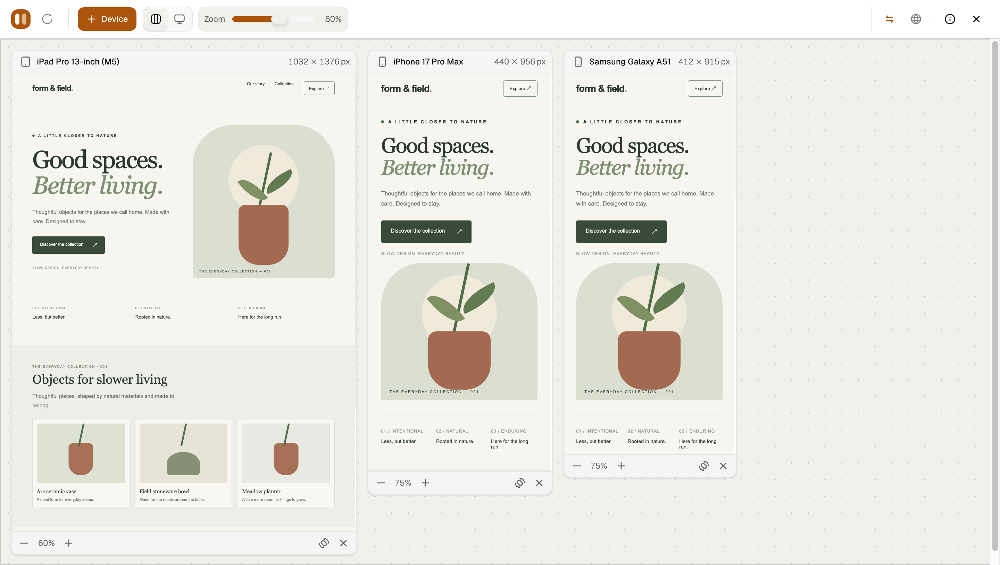

# ViewportStudio

ViewportStudio is a Chrome extension for checking a website across multiple responsive viewports in one workspace. Add device presets or custom dimensions, adjust zoom, and compare layouts side by side.



## Features

- Preview pages in mobile, tablet, and desktop viewport sizes.
- Choose presets for Apple, Google Pixel, Samsung, and generic desktop sizes, including Apple Duo and Samsung Galaxy Z Fold5 foldable pairs and QHD (2K) desktop resolution.
- Search the device catalog by name or category. The picker initially shows recent presets for each brand and lets you expand to older models.
- Add custom viewports and drag to resize them.
- Change each preview's zoom and orientation, and switch supported foldables between cover and unfolded dimensions.
- Use up to 12 viewports in a workspace.
- Arrange previews in a row or a focused view.
- Arrange devices in rows that stay in place when zoom changes. Drag a header beside another device to share its row, or into the space below a row to create a new one. Wide rows scroll horizontally; dragging near an edge scrolls the workspace automatically.
- Navigate controls with the keyboard and receive screen reader feedback for device search and notifications.
- Respect reduced motion preferences for workspace animations.
- Reload previews.
- Automatically connect supported page interactions and toggle synchronization across previews.
- Automatically handle blocked embeds within active workspace tabs, with a globe control to turn it off.
- Follow preview links with the browser's address bar and Back/Forward buttons while keeping the workspace open.
- Preserve the source website's color scheme in previews.

## Install from source

Requirements: Node.js, pnpm, and Chrome 120 or later.

To try ViewportStudio without downloading its source code, download [the standalone Chrome extension package](downloads/ViewportStudio-Chrome.zip), extract it, and load the extracted `ViewportStudio` folder in Chrome. The package contains only the built extension. ViewportStudio is not currently published in the Chrome Web Store.

```bash
pnpm install
pnpm package:chrome
```

This command builds the extension and creates a local `ViewportStudio/` folder that is ready to load in Chrome, as well as the downloadable ZIP above. To install the local build:

1. Open `chrome://extensions` and turn on **Developer mode**.
2. Choose **Load unpacked** and select this project's `ViewportStudio` folder.
3. Accept Chrome's requested site access so the extension can open on HTTP and HTTPS pages.
4. Open a website and click the ViewportStudio toolbar icon. The workspace opens over that page with its URL loaded in the viewports.

Use **Device** to add device presets or custom dimensions. Select a viewport to focus it, adjust its zoom or orientation in its footer, and drag its header to arrange it. Use the toolbar controls to change workspace zoom, switch between row and focus layouts, toggle synchronization, or manage embed handling. Click the extension icon again or use the workspace close button to close the overlay.

After making source changes, run `pnpm package:chrome` again, return to `chrome://extensions`, click the extension's reload button, and refresh any website where the old build was open. Update the downloadable ZIP in the repository with the generated `downloads/ViewportStudio-Chrome.zip` when preparing a new build for users.

An active workspace restores at the start of a page refresh, showing a small loading surface while its UI loads. A full browser refresh still replaces the document; closing the workspace keeps it closed on subsequent refreshes.

## Site access and embeds

ViewportStudio requests HTTP/HTTPS website access and `declarativeNetRequest` as required permissions during installation. Chrome may ask you to accept the expanded access when upgrading from the previous build. No per-site permission request or “Allow blocked embeds” dialog is shown in the workspace.

Opening a workspace automatically removes `X-Frame-Options` and `Content-Security-Policy` response headers from HTTP/HTTPS iframe responses in that tab. These iframe requests also send `Sec-Fetch-Dest: document` for compatibility with servers that refuse iframe destinations. Rules are installed before previews load and also cover redirects to other websites inside the workspace. They never target main-page requests or unrelated tabs. This changes site protections in the workspace; it cannot bypass every browser restriction, authentication policy, or frame-busting script.

The globe toggles automatic embed handling for the current workspace. Turning it off remains effective through worker reconnections and website navigation until the workspace closes. Closing an overlay, closing its tab, or navigating to a page outside HTTP/HTTPS removes that tab’s rule and resets the toggle. Multiple workspace tabs are tracked independently.

With synchronization enabled, preview links use the website's native routing. Routes within the same origin update the browser address bar without reloading the workspace or the source preview; the source preview keeps its SPA state and native Back/Forward history. Other previews follow the destination. Crossing to a different origin requires a real tab navigation, with device layout and zoom saved before restoring the workspace. App-generated routes and fragment changes are also followed. Modified clicks, downloads, and links targeting a new tab retain their normal behavior. Closing after an in-place route loads the matching real page. With synchronization off, previews navigate independently. Preview color schemes are taken from the original website, independently of the workspace's light UI.

Interaction scripts are declared in the manifest for HTTP/HTTPS frames, but only activate after identifying a ViewportStudio preview. Interactions connect automatically, and the shield reconnects previews when needed. Manage website access in Chrome’s extension settings. Old per-host script registrations and saved embed approvals are removed automatically on upgrade.
Previews share the browser's cookies and storage, so they are not isolated browser profiles. Some sites prevent interaction synchronization due to browser or site restrictions.

Website previews in the injected overlay load inside a small extension-origin bridge, with the website in a nested sandboxed iframe. This separates the website from the source document and workspace while permitting the site's own scripts, cookies, and storage. Chrome's third-party cookie and storage policies still apply. The bridge registers its Chrome-assigned frame identity with the worker so interaction scripts can reconnect even when cross-origin navigation clears the iframe name. Blank and sample previews use an opaque origin.

After rebuilding, reload ViewportStudio in `chrome://extensions` and refresh any website where it was already open. This replaces content scripts belonging to the previous extension build.

The injected workspace is one packaged classic script, including dialogs and font assets, executed in Chrome's isolated world. It does not request extension modules or add preload links to the website. Only `preview-frame.html` and its packaged script are web-accessible; the overlay, worker, and interaction scripts are not. Overlay styles use pixel values derived from a 16px base so a website's root font size cannot shrink the workspace; popups stay inside its shadow root. Website access permissions are unchanged by this bridge.

Device presets change the viewport dimensions. They do not emulate a mobile user agent, touch hardware, or a separate browser profile. Chrome DevTools device emulation runs the site as a top-level page and has additional browser-level controls; embedded previews cannot guarantee compatibility with every website. Browser-protected pages, sites that require top-level authentication, and pages with frame-busting behavior may need a regular browser tab. See the [compatibility test report](docs/compatibility-qa.md) for the sites and refresh flows actually tested.

## Keyboard shortcuts

Shortcuts work while focus is in the workspace UI:

| Action                 | macOS                       | Windows/Linux         |
| ---------------------- | --------------------------- | --------------------- |
| Reload previews        | `Option + R`                | `Alt + R`             |
| Zoom selected viewport | `Option + +` / `Option + −` | `Alt + +` / `Alt + −` |
| Close a dialog         | `Esc`                       | `Esc`                 |

For custom viewports, focus the resize handle and use arrow keys to adjust dimensions by 10 pixels, or hold Shift for 100 pixel steps. Press Enter to commit a dimension field or Escape to discard its pending edit. Focus mode automatically chooses a viewport when none is selected.

## Development

```bash
pnpm dev       # Run the Vite development server
pnpm build     # Type-check and build the Chrome extension into dist/
pnpm package:chrome # Build the loadable ViewportStudio folder and downloadable ZIP
pnpm lint      # Run ESLint
pnpm typecheck # Run the TypeScript check
pnpm test:unit # Run the unit tests
pnpm run react-doctor # Run React Doctor on the project
```

The build writes the extension to `dist/`; `pnpm package:chrome` copies that build to the ignored `ViewportStudio/` folder for loading in Chrome and updates the standalone ZIP. The MIT license is included in the extension package; other root-level documentation is not. Runtime files in `public/`, such as the extension icons and `preview-frame.html` bridge, are copied because the manifest and preview system require them. The built-in blank-workspace sample is source code bundled into the app, not a separate preview file.

React Doctor runs through `pnpm dlx`, so it does not become an extension dependency. See the [React Doctor CLI reference](https://www.react.doctor/docs/reference/cli-reference) for scan options.

## License

ViewportStudio is open source under the [MIT License](LICENSE).
